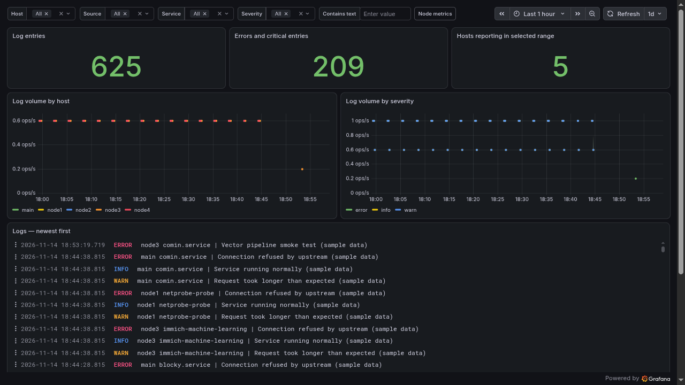

# Central logs

Every server (`main`, `node1`, `node2`, `node3`, and `node4`) runs Vector and
ships its system journal to Loki on `main`. NixOS-managed OCI containers already
use the journald logging driver, so their stdout and stderr arrive through the
same pipeline. This includes Comin deployments, Docker containers, systemd
services, SSH, and kernel messages. Application files that are not written to
the journal need an additional Vector file source.

## In Grafana

Open `http://grafana.s`, then **Dashboards → Infrastructure → Homelab Logs**.
The dashboard has:

- Host, source (`journal` or `container`), service, and severity selectors.
- A literal, case-sensitive **Contains text** search.
- Counts for log entries, errors/critical entries, and reporting hosts in the
  selected time range.
- Log-volume charts split by host and severity.
- A newest-first log list with timestamps, host/service context, and expandable
  details. It refreshes every ten seconds and displays up to 1,000 matching
  lines. Narrow the time range or use Explore to investigate further.
- A link to the node metrics dashboard that preserves the host and time range.

For example, choose `node3`, select `comin.service`, and search for `failed`
to inspect a deployment failure alongside that node's metrics. Select
**Source → container** to see container output.

Grafana **Explore → Loki** also supports these queries:

```logql
# All five nodes
{job="host-logs"} | json | line_format "{{.message}}"

# Deployment logs on node3
{job="host-logs",host="node3",service_name="comin.service"} | json

# Journal errors and critical events
{job="host-logs",level=~"error|critical"} | json

# Container output containing a literal string
{job="host-logs",source="container"} |= "connection refused" | json
```

Severity is derived from journal priority. Applications that write an error as
ordinary stdout may still appear as `info`; text search is available regardless
of severity. Process IDs and container IDs are not indexed labels. Suricata's
existing structured EVE stream and dashboard remain under `job="suricata"`.

Layout shown with synthetic sample data (not live node logs):



## Storage and delivery

- Loki stores all nodes' logs under `/var/lib/loki` on `main`, with 30-day
  retention enforced by its compactor. Loki has no configured disk-size cap;
  the separate 10GB Prometheus retention limit applies only to metrics.
- Each node keeps a persistent journal for up to 30 days or 1GiB, whichever
  limit is reached first.
- Each Vector agent has a 512MiB disk buffer under `/var/lib/vector`. It retries
  delivery when the collector is unavailable and stops consuming the journal
  when that buffer fills. Extended outages can still lose entries if the local
  journal rotates them away or Loki rejects entries that are too old.
- On its first deployment, collection starts with new journal entries. Later
  restarts resume from the persisted cursor, including across reboots.
- Vector's own service logs are excluded to avoid a delivery-error feedback
  loop; inspect those locally with `journalctl -u vector`.

Loki's HTTP and gRPC listeners stay on loopback. Caddy exposes only
`POST /loki/api/v1/push` on `10.10.10.1:3101`, restricted to the node IPs in
`router.lanHosts`; the firewall has the same source-IP restrictions. This is
HTTP within the trusted server LAN. Queries and administration remain local
to `main`, accessed through Grafana. Existing Grafana viewer access also
provides access to these logs.

## Deployment and verification

Deploy `main` first to start Loki and the ingestion endpoint, then deploy the
other nodes through Comin. No new secrets are required.

On each node, emit a message with `logger -t homelab-check "central logging
check"`. In Grafana select the node, clear the other filters, and search for
`central logging check` in the last five minutes. This verifies real delivery
from that node; an empty dashboard before deployment is expected.

Useful local checks:

```sh
systemctl status vector
journalctl -u vector --since '10 minutes ago'
# On main:
systemctl status loki caddy
curl -fsS http://127.0.0.1:3100/ready
# From another node, querying Loki's API through the push endpoint is denied:
curl -i http://10.10.10.1:3101/loki/api/v1/labels
```

The normalization tests run with:

```sh
nix build .#checks.x86_64-linux.logging --no-link --print-build-logs
```

Both the Build workflow and automated flake-update workflow run this check.
